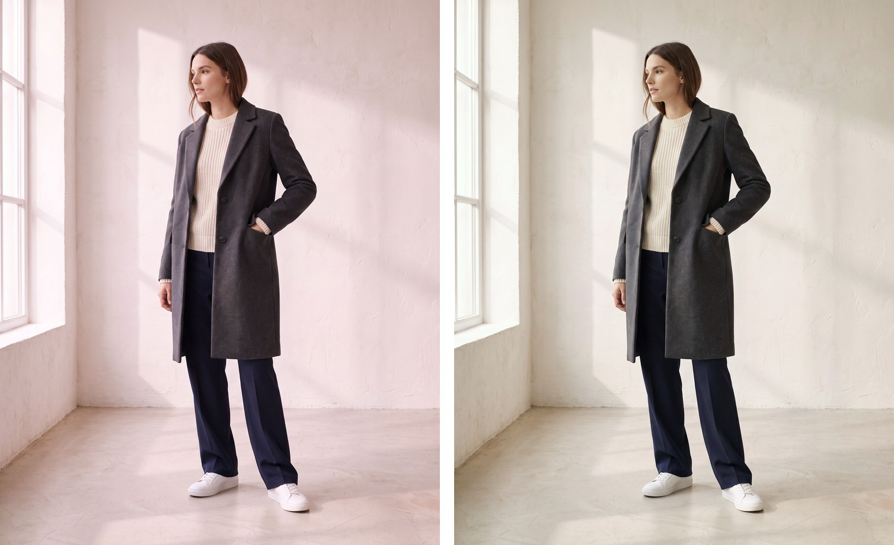
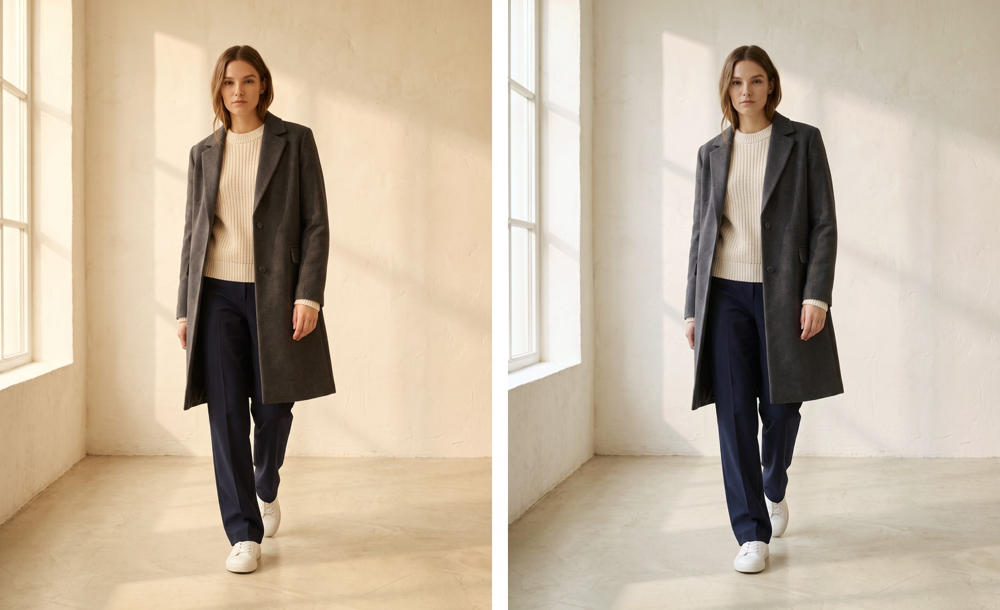
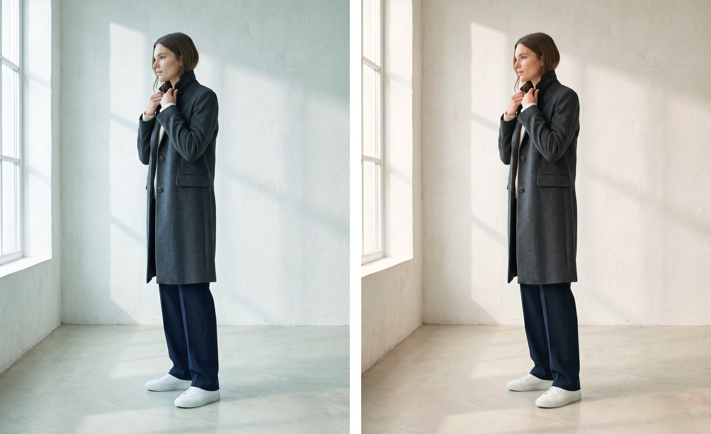

# Nano Corrector

**Make the backgrounds in a batch of photos all look the same.**

If you make a set of images with AI (Nano Banana, for example), the white wall
behind your subject often comes out a little pink in one picture, a little yellow
in the next, and a little gray in the third. Side by side, the set looks messy.

Nano Corrector fixes that. You pick **one** picture whose background looks right,
and it nudges every other picture's background to match.

- Your original photos are never touched. You get new copies.
- It runs on your own computer. Nothing is uploaded anywhere.
- It's free. No account and no API key.
- It makes a side-by-side "before / after" picture so you can check the result.

## See it work

Same photo set, same reference. Left is **before**, right is **after**.

**Too pink**


**Too yellow**


**Too blue**


The subject, the shadows and the sunlight stay the same. Only the wall color moves.

> **Heads up:** this is for sets of photos shot in the same kind of place, like a
> studio with a plain wall. It matches the *wall*, not the clothes or skin. It
> won't fix messy outdoor scenes or completely different lighting.

---

## What you need

1. **An AI assistant that can work with files on your computer.**
   Claude (Claude Code or the Claude desktop app) or ChatGPT's Codex both work.
   A plain chat window that only lets you type back and forth is not enough.
2. **Python** installed on your computer. Not sure if you have it? Skip it. Your
   AI will check, and tell you how to install it if it's missing.
3. **A folder of photos** (JPEG or PNG), and **one photo from that folder** whose
   background you like.

That's it. You do not need to type any code yourself.

---

## Install it (3 steps)

### Step 1. Download

Download the ZIP: **[nano-corrector-skill-v1.0.0.zip](releases/nano-corrector-skill-v1.0.0.zip)**
(on GitHub, click the file, then the download button).

### Step 2. Unzip

Double-click the ZIP. You'll get a folder called `nano-corrector`. Put it
somewhere easy to find, like your Desktop or Documents.

### Step 3. Tell your AI where it is

Open your AI assistant and paste the message below. Change the three parts in
`CAPITAL LETTERS`.

```text
Read the file SKILL.md inside my "nano-corrector" folder at
PATH-TO-NANO-CORRECTOR-FOLDER and set it up for me.

Then match the backgrounds of all the photos in PATH-TO-MY-PHOTOS
to this reference photo: PATH-TO-MY-FAVORITE-PHOTO

Save the results in a new folder next to my photos called "matched".
Include smaller JPEG copies too, and show me a before/after so I can check.
```

**How do I get a "path"?**

- **Mac:** right-click the folder, hold the **Option** key, then click
  **Copy "name" as Pathname**.
- **Windows:** hold **Shift**, right-click the folder, then click **Copy as path**.

Paste that where the CAPITAL LETTERS are.

The first time, your AI will install a few small helper tools. This can take a
minute or two. After that, it will process your photos and show you the results.

---

## What you get

Open the `matched` folder:

| What | Where | What it's for |
| --- | --- | --- |
| Your fixed photos | `jpeg/` folder | Small files. Use these to share and post. |
| Full-quality copies | the main folder (PNG) | Biggest files. Keep these as your masters. |
| Before / after pictures | `review/` folder | Check that it actually looks better. |
| A report | `report.json` | The numbers. You can ignore this one. |

PNG files are bigger than JPEGs but don't look sharper. That's normal.

---

## Use it again

Next time, you don't need to install anything. Just paste the message from
Step 3 again with new paths. Always save to a **new** folder name
(`matched-2`, `matched-3`...). It won't overwrite an old one.

**Want it to be permanent?** Ask your AI: *"Install the nano-corrector folder as a
skill so you can use it in every chat."* Then in the future you can just say
*"match the backgrounds in this folder to this photo."*

---

## If something goes wrong

| What you see | What to do |
| --- | --- |
| "Python not found" | Ask your AI: *"Help me install Python."* |
| "Output folder already exists" | Pick a new output folder name. |
| It says a photo can't be matched | That photo's wall is blocked or too different. Pick a better reference, or leave that one out. |
| The result looks off | Ask your AI to show you the `review/` pictures and try a different reference photo. |

Still stuck? Copy the error message and paste it to your AI. It can usually fix
it for you.

---

## For developers

How it works, command-line usage, tests, and how the project was built are in
**[docs/technical-details.md](docs/technical-details.md)**.

## License

[MIT](LICENSE). Free to use.
